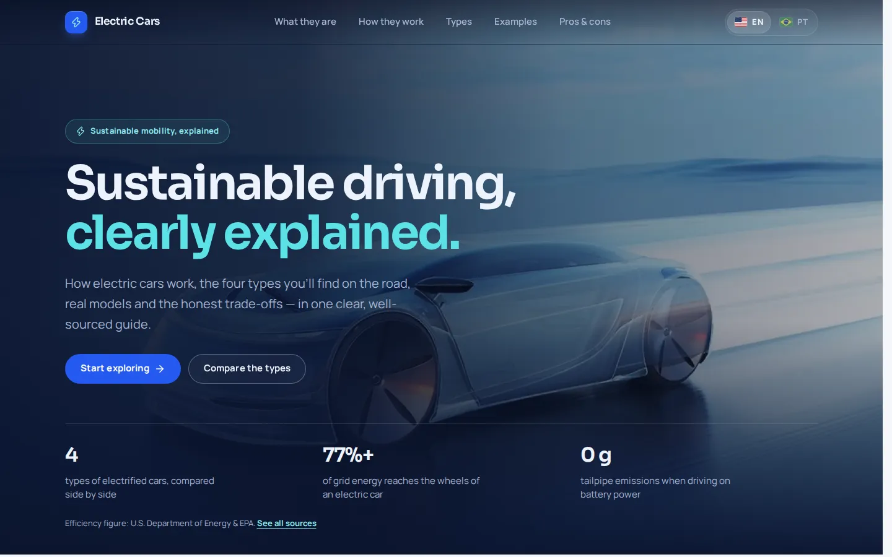
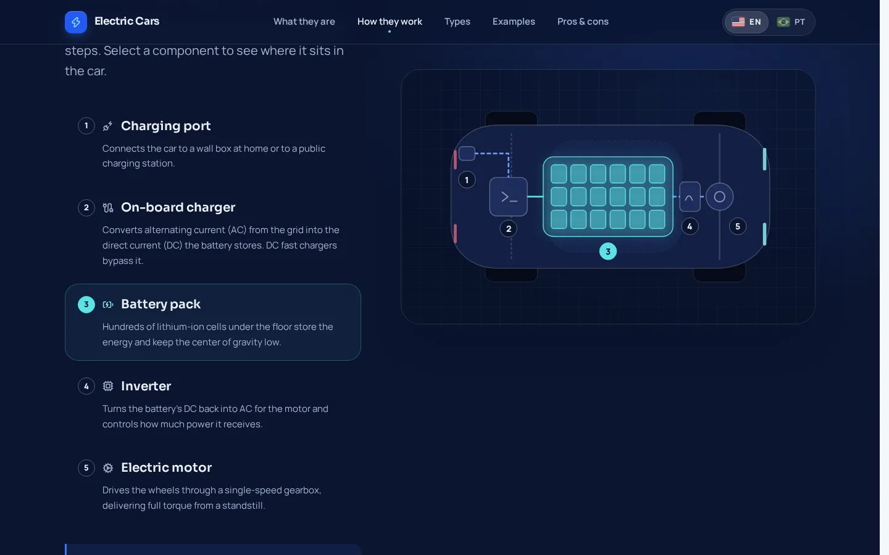
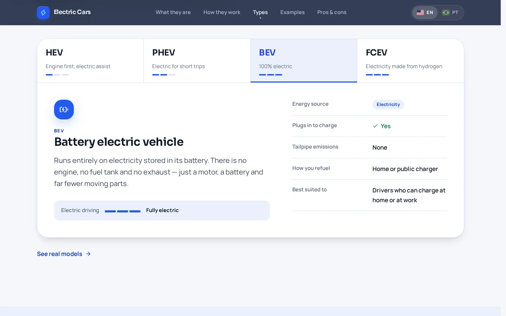
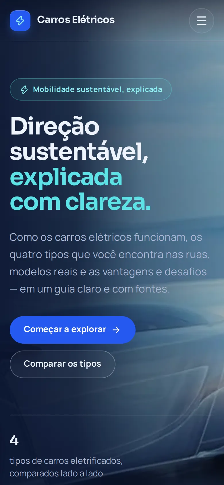
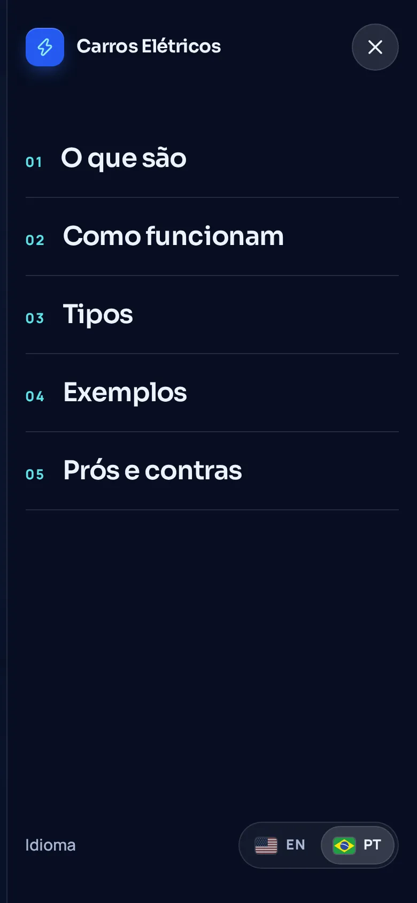

# Electric Cars — Angular

A bilingual (English / Brazilian Portuguese) landing page that explains electric and sustainable
cars: what they are, how they work, the four electrified powertrain types, models already on the
road and the honest trade-offs of switching.

It is a ground-up Angular rewrite of an academic project originally built with React for the
**Universidade Católica de Brasília**, keeping its content structure while rebuilding the
design system, accessibility, internationalization and engineering practices from scratch.



| Interactive drivetrain diagram                                      | Types explorer (WAI-ARIA tabs)                         |
| ------------------------------------------------------------------- | ------------------------------------------------------ |
|  |  |

| Mobile, in Portuguese                                              | Mobile navigation (native `<dialog>`)                |
| ------------------------------------------------------------------ | ---------------------------------------------------- |
|  |  |

## Highlights

- **Angular 21**, standalone components only, zoneless change detection, `OnPush` everywhere,
  signals for state and `inject()` for dependencies.
- **Runtime i18n without a library**: a typed `Messages` contract makes a missing translation a
  compile error; the language toggle switches instantly, is remembered, follows the browser on the
  first visit and keeps `<html lang>`, the title and meta tags in sync.
  See [ADR 0001](docs/adr/0001-runtime-typed-i18n.md).
- **Design system as tokens**: colour, fluid type scale, spacing, radii, shadows and motion live in
  [`src/styles/_tokens.scss`](src/styles/_tokens.scss); layouts rely on `clamp()`, auto-fit grids
  and a container query before reaching for breakpoints.
- **Accessibility first**: skip link, landmark structure, one `h1`, visible focus, WAI-ARIA tabs
  with arrow/Home/End keys, a native modal `<dialog>` menu, a carousel without autoplay, scrollspy
  with `aria-current`, `prefers-reduced-motion` support and automated **axe WCAG 2.2 AA** audits.
- **Performance**: lazy-loaded routes, self-hosted variable fonts, `NgOptimizedImage` with a typed
  loader over pre-generated responsive WebP variants (the original PNGs were up to 6 MB; the
  heaviest variant is now about 100 KB) and an SVG sprite for icons.
  See [ADR 0002](docs/adr/0002-static-asset-pipeline.md).
- **Sourced content**: every figure links to a primary source (U.S. DOE / EPA, AFDC, EEA).

## Tech stack

| Concern    | Choice                                                               |
| ---------- | -------------------------------------------------------------------- |
| Framework  | Angular 21 (standalone, zoneless, signals), TypeScript 5.9 strict    |
| Styling    | SCSS with CSS custom properties, Sora + Manrope via Fontsource       |
| Unit tests | Vitest through `@angular/build:unit-test` (jsdom)                    |
| End-to-end | Playwright (desktop + Pixel 7) and `@axe-core/playwright`            |
| Quality    | angular-eslint (TypeScript + template accessibility rules), Prettier |
| CI         | GitHub Actions: format, lint, unit tests, build, e2e                 |

No backend, no UI kit and no animation or icon library: the only runtime dependencies are Angular,
RxJS and the two font packages.

## Getting started

**Requirements:** Node.js `^20.19`, `^22.12` or `>=24`, and npm. Install from the lockfile with
`npm ci` — resolving the dependency tree from scratch needs npm 11, because npm 9/10 crash on
Vitest's optional peer dependencies.

```bash
npm ci
npm start            # http://localhost:4200
```

| Script           | What it does                                                    |
| ---------------- | --------------------------------------------------------------- |
| `npm start`      | Development server with live reload                             |
| `npm run build`  | Production build into `dist/electric-cars-angular/browser`      |
| `npm test`       | Unit tests in watch mode (`npm run test:ci` runs once)          |
| `npm run lint`   | ESLint for TypeScript, templates and e2e specs                  |
| `npm run format` | Prettier (`format:check` verifies without writing)              |
| `npm run e2e`    | Playwright journeys and axe audits (starts its own dev server)  |
| `npm run verify` | Format check, lint, unit tests and production build in sequence |

The first `npm run e2e` needs a browser: `npx playwright install --with-deps chromium`.

## Project structure

```
src/
├── app/
│   ├── core/                 # cross-cutting, framework-level building blocks
│   │   ├── images/           # typed NgOptimizedImage loader for pre-generated variants
│   │   ├── navigation/       # landing section ids, scrollspy service + directive
│   │   └── storage/          # localStorage wrapper that never throws
│   ├── i18n/                 # locale resolution, Messages contract, dictionaries,
│   │                         # signal store, title strategy, document metadata sync
│   ├── layout/               # site header, footer and language toggle
│   ├── shared/               # presentational pieces: icon, flag, brand mark, section heading
│   ├── features/
│   │   ├── landing/
│   │   │   ├── data/         # non-translatable typed content (ids, icons, attributes)
│   │   │   └── sections/     # hero, what-is, how-it-works, ev-types, examples, pros-cons, sources
│   │   └── not-found/
│   ├── app.config.ts         # zoneless, router (anchor scrolling), image loader, title strategy
│   └── app.routes.ts         # lazy routes
├── styles/                   # tokens, base, layout, buttons, mixins
└── testing/                  # shared TestBed providers for specs
e2e/                          # Playwright journeys and accessibility audits
docs/adr/                     # architecture decision records
```

Dependencies point inwards: `features` and `layout` use `shared`, `core` and `i18n`; nothing in
`core` or `shared` knows about a feature.

## Testing

- **Unit (Vitest):** pure logic (locale resolution, scroll state, image loader, safe storage),
  services (i18n store, scrollspy, title strategy, document sync) and component behaviour (tabs
  keyboard model, drivetrain selection, carousel controls, mobile menu, language toggle), plus an
  app-level integration spec. Structured as Arrange–Act–Assert, one behaviour per test.
- **End-to-end (Playwright):** the journeys a visitor actually takes — hero CTA to the types
  explorer, keyboard-only tabs, carousel, language switch persisted across reloads, browser
  language detection, mobile menu, 404 recovery and a read-through with zero console errors.
- **Accessibility (axe):** WCAG 2.2 AA audits for the landing page in both languages, every tab
  panel, the open mobile menu and the 404 page. Automated audits catch a subset of issues; keyboard
  and screen-reader behaviour is also covered by the specs above.

## Deployment notes

The build is a static bundle. Two settings depend on the final host:

- **Sub-path hosting** (for example GitHub Pages): build with
  `npm run build -- --base-href /<repository>/` and add an SPA fallback (copy `index.html` to
  `404.html`).
- **Social previews:** `og:image` in `src/index.html` is relative because the production domain is
  not known yet; crawlers require an absolute URL, so set it when the domain is defined.

## Credits

- Photographs and car images come from the original academic project and remain the property of
  their respective owners; they are used here for educational, non-commercial purposes. The
  drivetrain diagram, icons composition, favicon and all copy are original to this project.
- Icons: [Lucide](https://lucide.dev) (ISC) and [Simple Icons](https://simpleicons.org) (CC0);
  flag artwork adapted from [flag-icons](https://flagicons.lipis.dev) (MIT); fonts Sora and Manrope
  (SIL OFL 1.1). Full notices in [THIRD_PARTY_NOTICES.md](THIRD_PARTY_NOTICES.md).

## Author

**Mateus Vincenzi** — [GitHub](https://github.com/matsvincenzi) ·
[LinkedIn](https://www.linkedin.com/in/mateusvincenzi/) ·
[Instagram](https://www.instagram.com/matts.dev/)

Licensed under the [MIT License](LICENSE).
